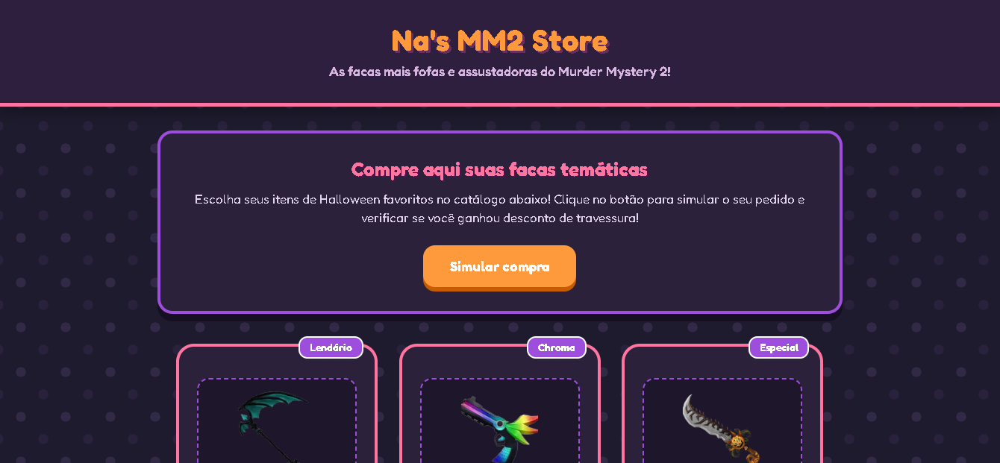

# Desafio 1 — Na's MM2 Store

**Aluno:** [Anandha Helena Dos Santos Ferreira]  
**Trilha:** [Desenvolvimento Mobile]  

---

## Apresentação da Loja
A ** Na's MM2 Store** é uma loja fictícia com temática de Halloween e inspirada no jogo **Murder Mystery 2 (Roblox)**. A interface combina estética *kawaii* com cores que assemelham ao dia das bruxas.

### Produtos e Preços
* **Nik's Scythe Cute:** R$ 150,00
* **Chroma Darkbringer:** R$ 45,00
* **Hallows Edge:** R$ 30,00

---

## Tecnologias Utilizadas
* **HTML5:** Estrutura semântica e importação da fonte externa *Fredoka* (Google Fonts).
* **CSS3:** Cores em tons pastel de Halloween, botões 3D estilo Roblox, sombras em camadas e layout flexível (Flexbox).
* **JavaScript:** Manipulação de eventos (`onclick`), leitura com `prompt()`, conversão segura com `Number()`, cálculos matemáticos e retorno via `alert()`.

---

## Instruções de Execução
1. Baixe este repositório:
2. Abra a pasta do projeto.
3. Abra o arquivo `index.html` em qualquer navegador web.
4. Clique no botão **" Simular compra "** para realizar o teste de pedido.

---

## Captura de Tela da Página

---

## Testes Realizados
1. **Seleção unitária:** Inserida 1 unidade da *Hallows Edge* e 0 nos outros. Total calculado corretamente em R$ 30,00.
2. **Nenhuma quantidade informada:** Digitado `0` para todas as facas. O sistema exibiu a mensagem *"Nenhum produto foi selecionado"*.
3. **Cancelamento do prompt:** Clicado em "Cancelar" nas caixas de diálogo. A função `Number()` com `|| 0` tratou a entrada como 0 perfeitamente.
4. **Aplicação do desconto:** Pedidos acima de R$ 100,00 receberam automaticamente 10% de desconto de Halloween.

---

## Dificuldade Encontrada e Aprendizados
* **Dificuldade:** Criar um visual que combinasse o tema de Halloween sem parecer sombrio, mantendo a estética do Roblox.
* **Aprendizado:** Aprendi a trabalhar com os programas e consegui ter um melhor aproveitamento do conteúdo estudado anteriormente.

---

## Uso de Inteligência Artificial
A Inteligência Artificial auxiliou na reformulação do CSS para a estética de Halloween e na estilização dos botões em formato 3D.

* **Adaptações:** Ajustei os textos dos prompts, as frases de desconto e os badges dos produtos para manter a coesão com a temática MM2 Roblox.
* **Verificação:** Todos os cálculos e validações do arquivo `script.js` foram testados no navegador para garantir 100% de conformidade com as regras do desafio.